<!-- repo-check: infra -->

  <a href="https://decoudjuan.github.io">
    <picture>
      <source media="(prefers-color-scheme: dark)" srcset="assets/header-dark.svg">
      
    </picture>
  </a>

  

I connect the tools a business already runs on — CRMs, automations and AI agents — and build them to keep working when something upstream fails.

Day to day that is n8n and Zapier pipelines against HubSpot, Salesforce and Pipedrive. On my own time it is shipped products, built to degrade gracefully instead of failing loudly.

---

## Selected work

### 🧪 meta-harness · Node.js

An AI agent that improves its own harness (instructions, skills, memory, guardrails) safely. Every change is tested in a sandbox against a task bank, with a blind holdout against reward hacking, and reaches the real harness only after a human approves it. *In development; private repo, demo on request.*

`self-improving agents` · `sandboxing` · `human in the loop` · `zero dependencies`

### 🐧 [Claude Pet](https://github.com/DecoudJuan/Claude-pet) · JavaScript

A desktop pet that shows what Claude Code is doing, and says what it is waiting for when it stalls on a permission prompt. No network and no transcript reading: it watches the JSON files that Claude Code's hooks write. [**Download →**](https://github.com/DecoudJuan/Claude-pet/releases/latest)

`Electron` · `Claude Code hooks` · `zero network` · `cross-platform`

### 🎸 [Guitar Learning](https://github.com/DecoudJuan/Guitar-Learning) · TypeScript

A guitar class that watches you play through the camera and corrects your fretting hand finger by finger. Runs entirely in the browser. [**Live →**](https://guitar-learning-ten.vercel.app)

`computer vision` · `homography` · `MediaPipe` · `zero backend`

### 🎵 [Migratify](https://github.com/DecoudJuan/Migratify) · Python

Migrates playlists between Spotify and YouTube Music without adding the wrong song: it scores every candidate, vetoes wrong artists and versions, and asks when it cannot tell two apart. [**Site →**](https://decoudjuan.github.io/Migratify/)

`weighted scoring` · `review queue` · `SQLite cache` · `bidirectional`

### 🐝 [Wasp](https://github.com/DecoudJuan/Wasp) · Rust

An OWASP Top 10 auditor that sweeps a repository for vulnerable patterns, secrets and dependencies, and reports in SARIF for CI. Incremental mode rescans only the diff.

`rust` · `SAST` · `SARIF` · `incremental scanning`

### 🎼 [Agent-Orchestra](https://github.com/DecoudJuan/Agent-Orchestra) · Python

A coding agent built from scratch on a raw agentic loop: an orchestrator and specialised sub-agents, with nothing hidden behind a framework.

`agentic loop` · `multi-agent` · `tool calling` · `no frameworks`

### 🧾 [Vexa](https://github.com/DecoudJuan/Vexa) · Python

A desktop invoicing app that replaced a legacy Microsoft Access system in a real business, with no ODBC driver or Access install needed at runtime.

`PySide6 / Qt` · `SQLite` · `legacy migration` · `PyInstaller`

### 🗺️ [Track Optimizer](https://github.com/DecoudJuan/TrackOptimizer) · JavaScript

Orders a list of stops into the shortest driving route, within about 5% of optimal, on open map services with no billing account. [**Live →**](https://trackoptimizer.vercel.app)

`2-opt` · `Leaflet` · `OSRM` · `no build step`

### ⚔️ [Isometric God of War](https://github.com/DecoudJuan/isometric-god-of-war) · JavaScript

A Vampire Survivors-style roguelite in the God of War universe, with pixel art generated entirely in code, in a single `index.html`. [**Play →**](https://decoudjuan.github.io/isometric-god-of-war)

`HTML5 Canvas` · `procedural pixel art` · `zero dependencies`

Also: <a href="https://github.com/DecoudJuan/ai-benchmarks-testing">ai-benchmarks-testing</a> — MMLU across 57 subjects plus agentic evaluation scored by an LLM judge · <a href="https://github.com/DecoudJuan/Mundialaustral">Mundialaustral</a> — match recommender for the Universidad Austral AI competition

---

## Stack

**Languages** — Python · TypeScript · Rust · Java · Kotlin · JavaScript · Embedded C

**AI &amp; Automation** — OpenAI API · prompt design · n8n · Zapier · webhooks

**Web** — React · NestJS · Flask · Express · Vite · PySide6 / Qt

**Data** — PostgreSQL · MySQL · SQLite · SQLAlchemy 2.0 · Prisma

**Cloud &amp; DevOps** — Azure · Docker · GitHub Actions · CI/CD · PyInstaller

**Integrations &amp; Auth** — HubSpot · Salesforce · Pipedrive · OAuth 2.0 · JWT · Auth0 · SOAP

---

## Documentos

- [assets/](assets/): el header (`header-light.svg` y `header-dark.svg`) y `gen.py`, el script de Python que los genera, para regenerarlos al cambiar el contenido.

## Licencia

MIT, ver [LICENSE](LICENSE).
